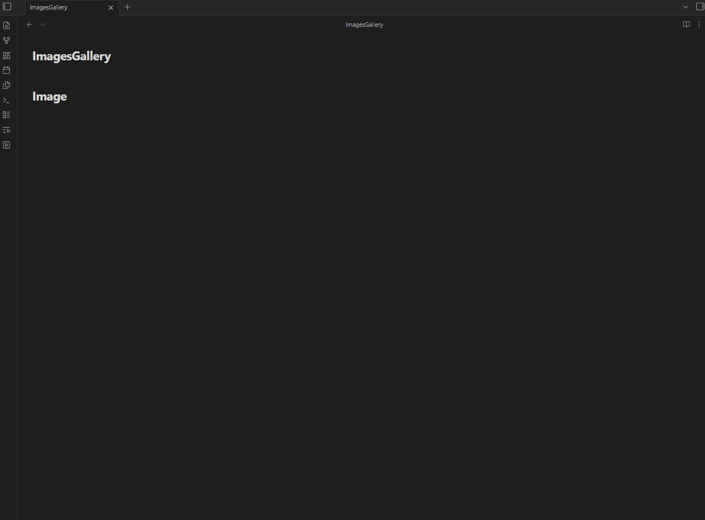

# Media Gallery

**Media Gallery lets you create galleries of your video, image, PDF and audio files directly inside your notes in Obsidian**

## Roadmap
- [x] Video support
- [x] Image support
- [x] PDF support
- [x] Audio support

## Examples

### 

**Video**


**Image**
 


## Installation

### Via BRAT (Beta)
1. Install the [BRAT plugin](https://github.com/TfTHacker/obsidian42-brat) in Obsidian.
2. Open BRAT settings and click "Add Beta Plugin".
3. Enter this repository URL: `https://github.com/RobertoJarquinRR/Media-Gallery-view`
4. Enable the plugin in Obsidian's Community Plugins settings.

### Via Obsidian Community Plugins
Search for "Media Gallery" in Obsidian's Community Plugins browser and install it directly.

## Usage

Create a code block with the language set to `MediaGallery` in any note. Specify a `path:` to the folder containing your media, and an optional `type:` to choose between a video, image, PDF or audio gallery. If `type:` is omitted, the gallery uses the default type configured in the plugin settings (video by default).

````md
```MediaGallery
path: directory/videos
type: video
```
````

````md
```MediaGallery
path: directory/images
type: image
```
````

````md
```MediaGallery
path: directory/books
type: pdf
```
````

````md
```MediaGallery
path: directory/music
type: audio
```
````

The plugin will render all matching files found in the specified folder as a gallery grid.

- **Video gallery**: hover a card to reveal playback controls. Clicking a card opens the overlay without starting playback; use the controls to play.
- **Image gallery**: click a card to open it in a fullscreen lightbox. Close it by clicking the background or pressing `Esc`.
- **PDF gallery**: click a card to open it in the built-in reader; pages render as you scroll. Double-click a card or a page to open the PDF in a new Obsidian tab or with the system app (configurable in settings). Close it by clicking the black background or pressing `Esc`.
- **Audio gallery**: click a card to open the built-in player; move between tracks with the overlay arrows or the thumbnail strip. Autoplay can be enabled in settings.
- **Thumbnails**: Image, PDF and audio thumbnails are generated on demand and cached in the plugin folder. Audio artwork is read from the file tags or from a cover image in the same folder. You can use your own images with the custom thumbnail folder setting.
- **All galleries**: `Esc` closes the overlay, and double-clicking a card opens the file using the "Open files with" setting.

PDF and audio support require Obsidian 1.5.8 or newer.

## Recommendation

For a better video playback experience, consider installing the **Media Extended** plugin. Note that this only improves playback when you open a video in a separate note — the gallery itself renders videos with the default HTML5 player for performance reasons.

## Credits

PDF rendering is powered by [PDF.js](https://github.com/mozilla/pdf.js) (Apache-2.0).
Audio metadata extraction is powered by [music-metadata](https://github.com/Borewit/music-metadata) (MIT).